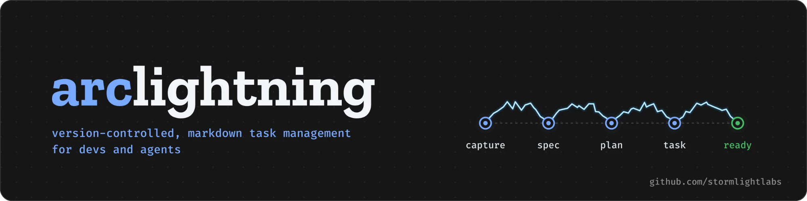
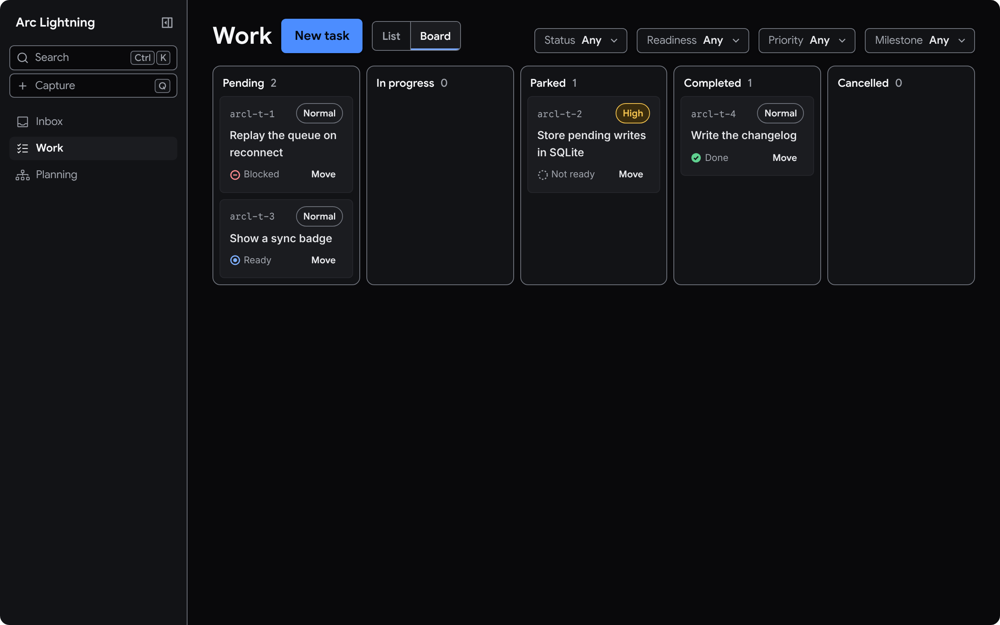
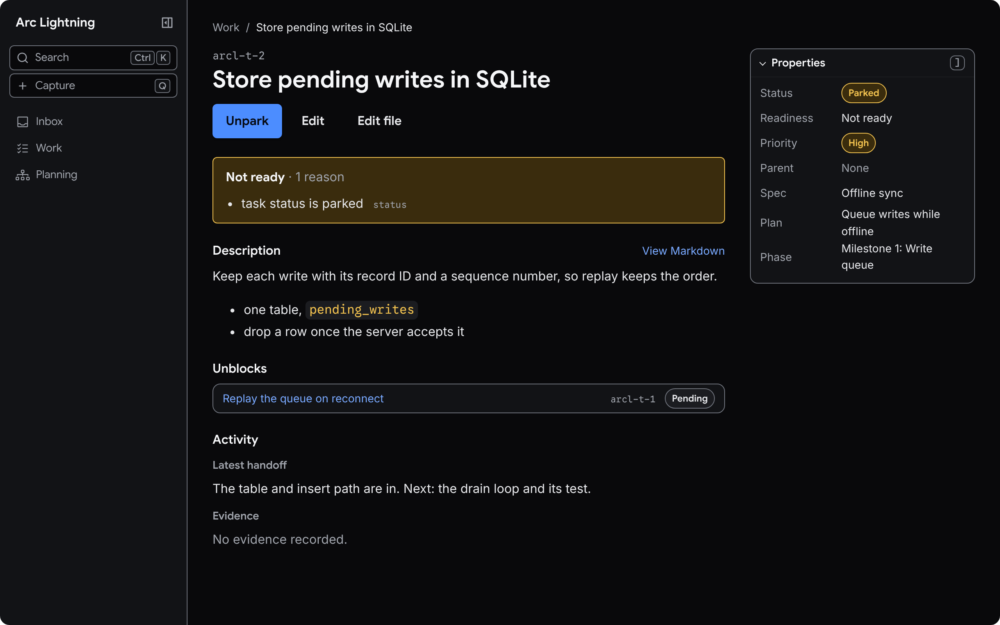

<p align="center">
  
</p>

# Arc Lightning (`arcl`)

A local-first project planning and execution CLI for developers and their agents.
Arc Lightning keeps the live tracker in `.arcl/arcl.db` and can optionally use a
Git worktree for repository-native project files.

<p>
  
  
</p>

## Quick start

Install `arcl` on macOS or Linux:

```sh
curl --proto '=https' --tlsv1.2 -LsSf https://github.com/stormlightlabs/arclightning/releases/latest/download/arcl-cli-installer.sh | sh
```

On Windows, in PowerShell:

```powershell
powershell -ExecutionPolicy Bypass -c "irm https://github.com/stormlightlabs/arclightning/releases/latest/download/arcl-cli-installer.ps1 | iex"
```

Or with Homebrew or `cargo binstall`:

```sh
brew install stormlightlabs/tap/arcl
cargo binstall --git https://github.com/stormlightlabs/arclightning arcl-cli
```

These install a prebuilt binary that includes the web app `arcl serve` opens.
`cargo binstall --git` takes the version from `main`. When `main` carries a
version that is not released yet, it finds no archive and compiles from source
without the web app. To pin a release, and fail instead of compiling, install
from a clone of its tag:

```sh
git clone --depth 1 --branch v<version> https://github.com/stormlightlabs/arclightning
cargo binstall --manifest-path arclightning --disable-strategies compile arcl-cli
```

To compile it instead, run
`cargo install --git https://github.com/stormlightlabs/arclightning arcl-cli`.
That build leaves out the web app.

Arc Lightning initializes ordinary directories directly and discovers the nearest
project when commands run from any descendant directory. Inside a non-bare Git
worktree, initialization uses the worktree root.

```sh
# From a new or existing project directory
arcl init
```

`init` creates the following structure in your project:

```sh
.arcl
├── .gitignore      # ignores sqlite, temp files & conflict artifacts
├── config.toml
└── arcl.db
```

## Daily workflow

Capture a thought, promote it to an owned specification, create a plan, and add
work to that plan:

```sh
capture=$(arcl --json capture create "Improve import errors" --body "Make failures easier to fix.")
capture_id=$(printf '%s' "$capture" | jq -r '.data.capture.id')
spec=$(arcl --json capture promote "$capture_id" spec --acceptance-criteria "Imports reject invalid records.")
spec_id=$(printf '%s' "$spec" | jq -r '.data.spec.id')
plan=$(arcl --json plan create "Import validation" --spec "$spec_id")
plan_id=$(printf '%s' "$plan" | jq -r '.data.plan.id')
arcl task create "Validate records" --plan "$plan_id" --priority high
arcl ready
```

Small work can move directly from a capture to a task:

```sh
arcl capture promote arcl-c-… task --priority high
```

## Agents

Give a coding agent the Arc Lightning skill, which teaches it to pick up, hand
off, and complete tasks with `arcl --json`:

```sh
npx skills add stormlightlabs/arclightning --skill arclightning
```

## Local development

Build and check the CLI from the repository root:

```sh
cargo build
cargo test --workspace --all-features
```

This repository keeps its roadmap and tasks in `.arcl/workspace`, which is
its only plan. On a fresh clone, run `arcl init`; the next command imports
them. Run `arcl tree` for the whole plan and `arcl ready` for the work that can
start.

`arcl tree` folds finished milestones and sums up the inbox in a footer. Here
it is on this repository, with the tasks of milestones 5 and 7 cut:

```text
◐ Arc Lightning first release and desktop app
└── ◐ Roadmap
    ├── ✓ Milestones 1–4  done · 20 tasks
    ├── ◐ Milestone 5: Agent interface  7/7
    ├── ✓ Milestone 6: Shared interface system  done · 1 task
    ├── ◐ Milestone 7: Local web app  15/21
    ├── ○ Milestone 8: Website and documentation  0/1
    │   └── ● T14: Rebuild the website and documentation shell
    ├── ○ Milestone 9: Integrated release  0/2
    │   ├── ○ T15: Verify the integrated release  blocked by B7MS
    │   └── ● Publish release binaries with dist and support cargo-binstall
    ├── ○ Milestone 10: Desktop planning and execution  0/2
    │   ├── ○ T12: Build the desktop shell and project inbox  blocked by EGMS
    │   └── ○ T13: Add desktop work, planning, and task views  blocked by AGNY
    └── ◐ Milestone 11: CLI formatting  5/6
        ├── ✓ Accept and show short record IDs
        ├── ✓ Show status on each arcl tree line
        ├── ✓ Leave closed captures out of arcl tree by default
        ├── ✓ Put the plan first in arcl tree
        ├── ✓ Fold finished milestones in arcl tree
        └── ● Add full and outline styles to arcl tree
Inbox: 24 open · Notes: 17 · Releases: v0.1.0, v0.2.0
```

Install the pnpm workspace and run the documentation site:

```sh
pnpm install
pnpm dev:website
```

Documentation content lives in `apps/website/src/content/docs/`. Verify the
site with `pnpm --filter @arclightning/website build`.

The web app in `apps/web` is the local UI for the workspace's tasks, which
`arcl serve` serves on 127.0.0.1. [apps/web/README.md](apps/web/README.md)
covers its tests, including a fast loop for UI work. CI runs `just check`,
which leaves the browser tests out.

To dogfood the app on claude.ai,
`pnpm --filter @arclightning/web build:artifact` builds it as an artifact page
in `apps/web/build-artifact/index.html`. The manual's "Publishing and syncing
the artifact" covers publishing it and `arcl web export` and `arcl web apply`.

## Releasing

dist builds a release only when the tag matches the version in Cargo.toml.

1. In a pull request, set the new version in `workspace.package.version` in
   `Cargo.toml` and in `package.json`, `apps/web/package.json`,
   `apps/desktop/package.json`, `apps/desktop/src-tauri/Cargo.toml`,
   `apps/desktop/src-tauri/tauri.conf.json` and `packages/ui/package.json`.
   Run `dist plan --tag=v<version>` to check it.
2. Once it merges, dispatch the Bump workflow with tag `v<version>` and that
   commit. The tag starts `.github/workflows/release.yml`.
