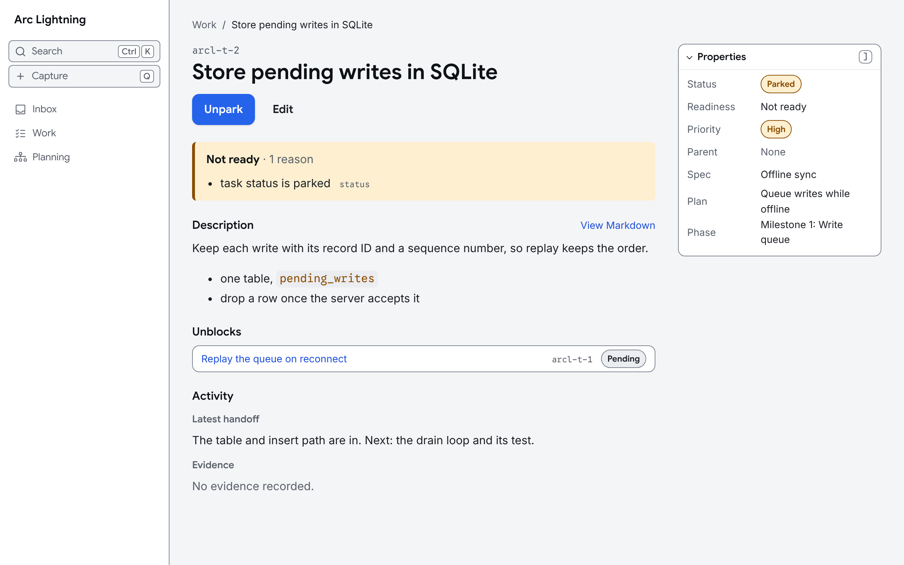
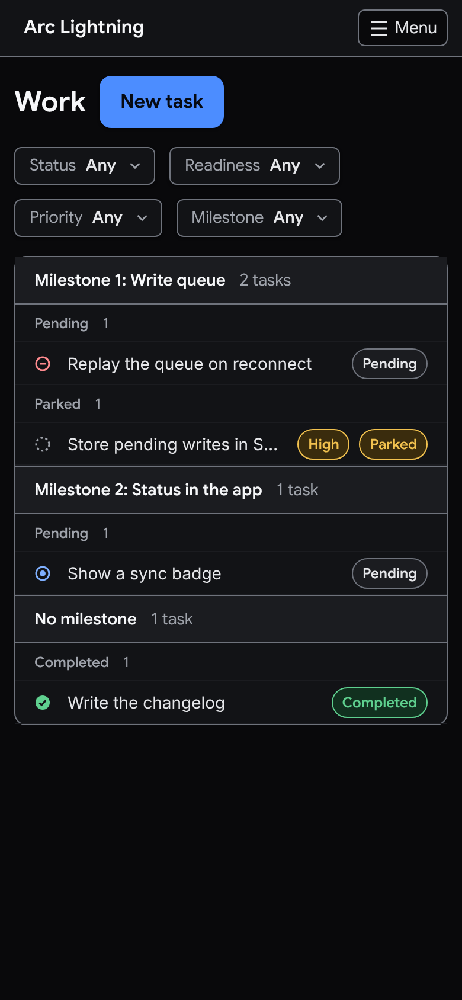

# Arc Lightning (`arcl`)

A local-first project planning and execution CLI for developers and their agents.
Arc Lightning keeps the live tracker in `.arcl/arcl.db` and can optionally use a
Git worktree for repository-native project files.

<p>
  
  
</p>

## Quick start

Arc Lightning initializes ordinary directories directly and discovers the nearest
project when commands run from any descendant directory. Inside a non-bare Git
worktree, initialization uses the worktree root.

```sh
# From a new or existing project directory
arcl init
```

`init` creates the following structure in your project:

```sh
.arcl
├── .gitignore      # ignores sqlite, temp files & conflict artifacts
├── config.toml
└── arcl.db
```

## Daily workflow

Capture a thought, promote it to an owned specification, create a plan, and add
work to that plan:

```sh
capture=$(arcl --json capture create "Improve import errors" --body "Make failures easier to fix.")
capture_id=$(printf '%s' "$capture" | jq -r '.data.capture.id')
spec=$(arcl --json capture promote "$capture_id" spec --acceptance-criteria "Imports reject invalid records.")
spec_id=$(printf '%s' "$spec" | jq -r '.data.spec.id')
plan=$(arcl --json plan create "Import validation" --spec "$spec_id")
plan_id=$(printf '%s' "$plan" | jq -r '.data.plan.id')
arcl task create "Validate records" --plan "$plan_id" --priority high
arcl ready
```

Small work can move directly from a capture to a task:

```sh
arcl capture promote arcl-c-… task --priority high
```

## Agents

Give a coding agent the Arc Lightning skill, which teaches it to pick up, hand
off, and complete tasks with `arcl --json`:

```sh
npx skills add stormlightlabs/arclightning --skill arclightning
```

## Local development

Build and check the CLI from the repository root:

```sh
cargo build
cargo test --workspace --all-features
```

This repository keeps its roadmap and tasks in `.arcl/workspace`, which is
its only plan. On a fresh clone, run `arcl init`; the next command imports
them. Run `arcl tree` for the whole plan and `arcl ready` for the work that can
start.

Install the pnpm workspace and run the documentation site:

```sh
pnpm install
pnpm dev:website
```

Documentation content lives in `apps/website/src/content/docs/`. Verify the
site with `pnpm --filter @arclightning/website build`.

The web app's browser tests need Chromium; set
`PLAYWRIGHT_CHROMIUM_EXECUTABLE_PATH` to use one already installed. CI runs
`just check`, which leaves them out.

```sh
pnpm --filter @arclightning/web test:browser  # Svelte components in Chromium
pnpm --filter @arclightning/web test:e2e      # workflows, fit and themes
pnpm --filter @arclightning/web test:visual   # screenshots against local baselines
pnpm --filter @arclightning/web screenshots   # rewrite the README images
```

`test:e2e` builds the web app and `arcl`, then runs a keyboard-only workflow
against `arcl serve` on a scratch project and checks each result with the CLI.
The other tests answer the API from `apps/web/e2e/fixtures.json`. Set
`WEB_E2E_PORT` when port 4174 is taken. Screenshot baselines are not
committed. The first `test:visual` run writes them to `apps/web/e2e/*-snapshots`
and fails each test as missing a baseline; later runs compare against them.
After an intended visual change, run `test:visual:update` and review the new
screenshots. `screenshots` draws the
README images in `docs/images/` from the same fixtures at twice the density.
